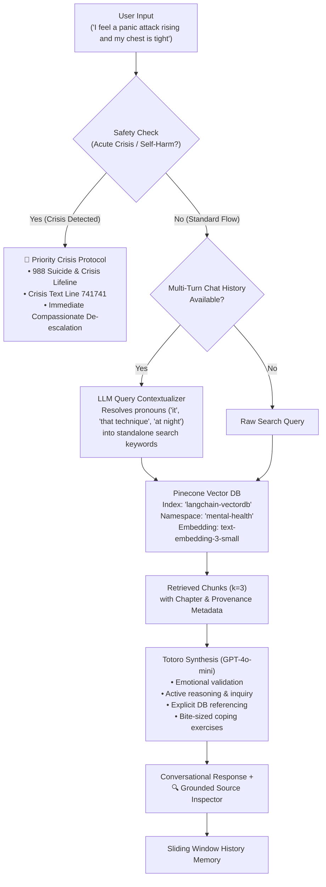

# 🌿 Totoro

> **An Evidence-Grounded Conversational Mental Health RAG Companion**  
> *Active reasoning, empathetic inquiry, and practical coping techniques grounded in psychoeducational science.*

[](https://www.python.org/)
[](https://streamlit.io/)
[](https://www.langchain.com/)
[](https://www.pinecone.io/)
[](https://openai.com/)
[](LICENSE)

---

## 📖 Overview

Most naive RAG (Retrieval-Augmented Generation) applications act as sterile search engines: a user asks a question, the system grabs text fragments, and dumps an impersonal summary. 

When someone is struggling with mental health challenges—such as panic attacks, depressive inertia, catastrophic thinking, or chronic burnout—a superficial summary is inadequate.

**Totoro** is an intermediate-level conversational RAG companion designed to:
1. **Actively Listen & Validate**: Gently acknowledge the person's emotional state without judgment or robotic dismissal.
2. **Ask Clarifying Questions**: Gently inquire about symptoms (e.g., *"Do you notice this more as physical chest tightness, or is it racing catastrophic thoughts?"*) to understand the root need before offering advice.
3. **Reason with Grounded Evidence**: Directly reference evidence-based coping frameworks (CBT, DBT, somatic grounding, behavioral activation) from its curated mental health knowledge base.
4. **Mitigate Step-by-Step**: Guide the user through one or two bite-sized, doable actions right now.
5. **Enforce Safety & Crisis Guardrails**: Prioritize immediate 24/7 confidential crisis lifelines (988, Crisis Text Line) if acute distress or self-harm is detected.

---

## 🏛️ Architecture & Request Flow



---

## ✨ Key Features

- **Empathetic Psychoeducational Persona**: Modeled on validated principles from Cognitive Behavioral Therapy (CBT), Dialectical Behavior Therapy (DBT), and mindfulness practices.
- **Idempotent Vector DB Architecture**: Dedicated namespace isolation (`mental-health`) with deterministic chunk IDs. Checks existing vector count on startup to avoid expensive duplicate re-embeddings.
- **Semantic Chapter Chunking**: Uses `RecursiveCharacterTextSplitter` with heading-aware separators (`## Chapter`, `### Section`), preserving whole coping techniques together.
- **Contextual Query Reformulation**: Follow-ups like *"Can you walk me through the breathing exercise you mentioned?"* are automatically contextualized into *"4-7-8 breathing technique instructions for anxiety"* before vector search.
- **Transparent Provenance**: Under every message, an expandable card shows the exact chapters, excerpts, and search terms that informed the response.
- **Calming Streamlit UI**: Crisp pure white canvas with soothing forest green accents, quick-start prompt shortcuts, and instant chat-clearing controls.

---

## 📚 Curated Knowledge Base

Totoro is grounded in [`mental_health_guide.txt`](mental_health_guide.txt) (~13 KB, 36 semantic chunks), a curated psychoeducational resource covering:

- **Chapter 1: Understanding Anxiety & Panic**: Generalized Anxiety, Social Anxiety, Panic attacks, 4-7-8 Breathing Technique, 5-4-3-2-1 Sensory Grounding, Progressive Muscle Relaxation.
- **Chapter 2: Understanding Depression**: Identifying depressive patterns, behavioral activation, self-compassion pauses, sleep hygiene, nutrition, gentle movement.
- **Chapter 3: Stress Management & Burnout**: Chronic stress physiology, mindfulness meditation, Eisenhower priority matrix, healthy boundary setting.
- **Chapter 4: Building Resilience**: Cognitive restructuring, reframing all-or-nothing distortions, social support systems.
- **Chapter 5: Professional Care Guide**: Differences between Psychiatrists, Psychologists, and Counselors; overview of CBT, DBT, EMDR, and ACT; directory resources.
- **Chapter 6: Supporting Someone in Distress**: Empathetic listening do's and don'ts.
- **Chapter 7: Daily Mental Wellness Routines**: Morning grounding, evening wind-down habits, and weekly check-in questions.
- **Chapter 8: Emergency Lifeline Directory**: 988 (US/Canada), Crisis Text Line 741741, Trevor Project, and FindAHelpline international resources.

---

## 🚀 Getting Started

### 1. Prerequisites
- Python 3.11 or higher
- An [OpenAI API Key](https://platform.openai.com/) (for embeddings and chat reasoning)
- A [Pinecone API Key](https://www.pinecone.io/) (free serverless tier supported)

### 2. Clone the Repository
```bash
git clone https://github.com/Meesum9/Totoro.git
cd Totoro
```

### 3. Environment Setup

Create your `.env` file from the provided template:
```bash
cp .env.example .env
```

Edit `.env` with your API credentials:
```env
OPENAI_API_KEY=your_openai_api_key_here
PINECONE_API_KEY=your_pinecone_api_key_here
PINECONE_INDEX_NAME=langchain-vectordb
```

### 4. Install Dependencies

Using **`uv`** (recommended for high speed):
```bash
uv sync
```

Or using standard **`pip`**:
```bash
python -m venv .venv
source .venv/bin/activate  # On Windows: .venv\Scripts\activate
pip install -r pyproject.toml
```

### 5. Launch Totoro

Run via Streamlit:
```bash
uv run streamlit run app.py
```
Or launch via the entrypoint script:
```bash
uv run python main.py
```

Open your browser at **`http://localhost:8501`**.

---

## 🛡️ Safety & Medical Disclaimer

> **IMPORTANT NOTICE:**  
> **Totoro is an educational, supportive AI companion and is NOT a medical device, licensed medical practitioner, psychiatrist, or emergency service.**  
> It cannot diagnose mental health conditions, prescribe medication, or provide clinical crisis therapy.
>
> **If you or someone you know is in immediate danger or experiencing thoughts of self-harm or suicide:**
> - **In the US & Canada:** Call or text **988** (available 24/7, free, confidential)
> - **Crisis Text Line:** Text **HOME to 741741**
> - **In the UK:** Call **111** or text **SHOUT to 85258**
> - **International:** Visit **[findahelpline.com](https://findahelpline.com/)** for free local crisis contacts.

---

## 📄 License

This project is licensed under the [MIT License](LICENSE).
